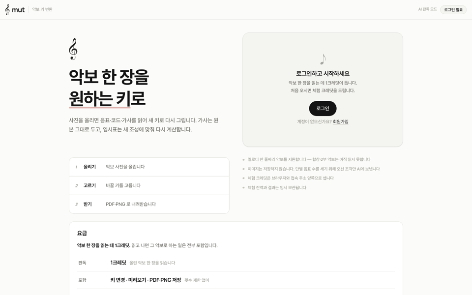
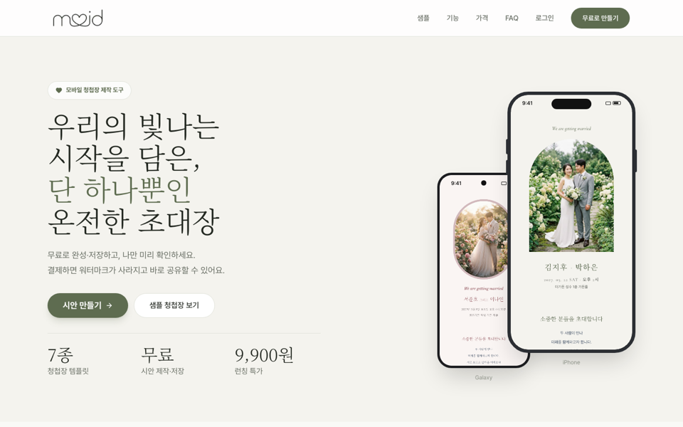

<!-- 2026-10 개편. 상태 배지는 pf.eungming.com 서버가 1분마다 직접 확인한 값 -->
<div align="center">
  
</div>

<div align="center">
  <a href="https://pf.eungming.com"></a>
</div>

<p align="center">
  <a href="https://pf.eungming.com"></a>
  <a href="https://pf.eungming.com"></a>
  <a href="https://eungming.com"></a>
  <a href="mailto:zxcyui6181@gmail.com"></a>
  <a href="https://www.linkedin.com/in/min-hwang-071b18316/"></a>
</p>

---

### 🧑🏻‍💻 About

```text
now      AI센터 · 그룹사 8개 계열사 RPA 900+ 과제 단독 운영
         공통 모듈 표준화로 월 장애 90 → 10건 · n8n·LLM·MCP로 운영 자동화
before   HEXAVEIL · Kotlin/Spring Boot·Django API, React/Next.js, Flutter (커머스)
side     집 서버(monsil) 한 대로 서비스 6개를 직접 만들고 운영
```

### 🚀 Featured

<table>
  <tr>
    <td width="50%" valign="top">
      <a href="https://pf.eungming.com"></a>
      <h4>🎼 뮤직시트 (MuT)</h4>
      악보 사진 → 원하는 키의 새 악보. AI에 통째로 맡기던 1세대를 <b>CV 검출 + AI 판독 + MusicXML 재조판</b>으로 다시 설계했습니다.<br/><br/>
      <code>727/727 음높이</code> <code>141/141 코드</code> <sub>(내부 표본)</sub><br/>
      <sub>Python · YOLO · OpenCV · Claude API · Verovio</sub>
    </td>
    <td width="50%" valign="top">
      <a href="https://moid.co.kr"></a>
      <h4>💌 MOID</h4>
      블록을 쌓아 만드는 모바일 청첩장 SaaS. 로그인 없이 시안을 만들고, 결제하면 워터마크가 사라집니다.<br/><br/>
      <a href="https://moid.co.kr"><code>moid.co.kr ↗</code></a><br/>
      <sub>Next.js · Prisma · AWS S3 · GitHub Actions</sub>
    </td>
  </tr>
</table>

| | 프로젝트 | 한 줄 |
|:-:|---|---|
| ⚙️ | **RPA 운영** | UiPath 경험 없이 1개월 만에 900개 과제 단독 인수 → 월 장애 90 → 10건 |
| 🤖 | **[포트폴리오](https://github.com/minhwang72/portfolio)** | 서비스 상태판 + RAG 챗봇 (Gemini 임베딩 검색 → Claude 답변, 출처 표시) |
| 📈 | **[Balance Desk](https://stock.eungming.com)** | KIS Open API 기반 ISA 포트폴리오 대시보드, 목표 비중 이탈 알림 |
| 📝 | **[CBT 학습](https://cbt.eungming.com)** | 정보처리기사 기출 6년치를 정리한 시험 연습 사이트 |
| 🔮 | **오늘운** | 토스 앱 안에서 도는 사주 운세 미니앱 (계산은 전부 휴대폰에서) |

### 🛠 Tech Stack

<p align="center">
  
  
  
  
  
  <br/>
  
  
  
  
  
  
  <br/>
  
  
  
  
  
  <br/>
  
  
  
  
  
</p>

### 🏅 Certifications

<p align="center">
  <a href="https://www.credly.com/badges/59b07b26-51a1-43df-b080-a2ff6b39bbd4/public_url"></a>
  
</p>

<p align="center"><sub>대부분의 저장소는 비공개입니다. 궁금한 건 <a href="https://pf.eungming.com">포트폴리오의 AI</a>에게 묻거나 메일 주세요 → <b>zxcyui6181@gmail.com</b></sub></p>


