  

  

  
  
  
  

 

### 👋 Hi, I'm Min

- 🏢 AI센터에서 사내 웹앱과 서버를 만들고 관리합니다 (Next.js · Docker · nginx)
- 🔧 이전엔 Kotlin/Spring Boot · Django API, React · Flutter 앱을 개발했습니다
- 🏠 사이드 프로젝트는 홈서버에 직접 배포해서 운영합니다
- 🌱 요즘 관심사: LLM 에이전트, RAG, MCP

### 🛠 Tech Stack

 

